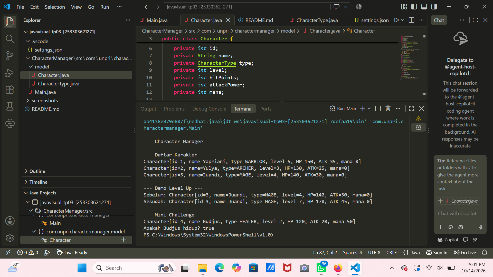

# Character Manager — TP3 (Java Visual SIH-6406)

Project ini adalah fondasi model class untuk aplikasi Character Manager yang dibangun dengan Java. Berisi class `Character` untuk data karakter, enum `CharacterType` untuk jenis karakter, dan `Main` untuk demo. Sebagai ekstensi mandiri, ditambahkan atribut `mana` (dengan validasi) dan method `isAlive()`.

## Screenshot Output



## Struktur Folder

```
javavisual-tp03-253303621271/
├── .vscode/
│   └── settings.json
├── CharacterManager/
│   └── src/
│       └── com/unpri/charactermanager/
│           ├── Main.java
│           └── model/
│               ├── Character.java
│               └── CharacterType.java
├── screenshots/
│   └── OutputYapri.png
└── README.md
```

## Identitas

- Nama lengkap : (Yapriani Damenta Sidabutar)
- NIM          : 253303621271
- Analisis Bagian D (Google Docs) : (https://docs.google.com/document/d/1_BLhfeichR7MFemT1GjWmHpHmhlF6gQWWLUap9tWeM0/edit?usp=sharing)