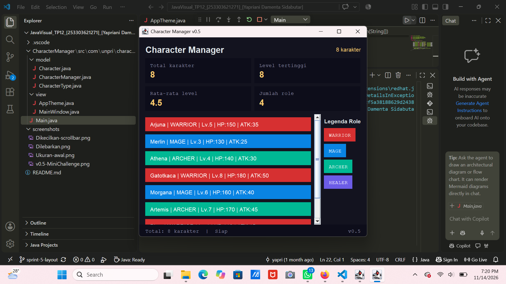
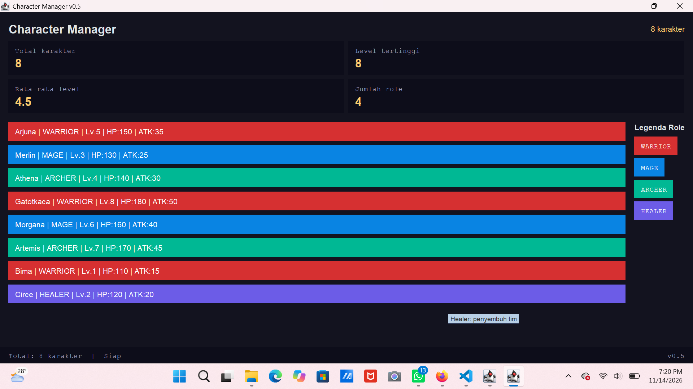
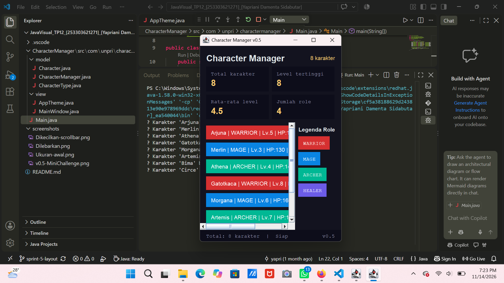
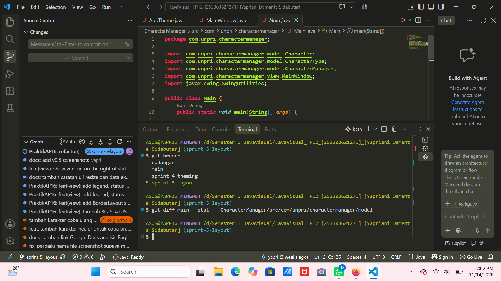

---

## TP12 - Layout, UI Responsif & Analisis MVC (Sprint #5)

Pada sprint ini, tampilan Character Manager dinaikkan dari v0.4 ke v0.5. Sebelumnya semua kartu karakter hanya ditumpuk dalam satu panel `GridLayout`, sehingga kalau datanya banyak jendela jadi sangat tinggi. Sekarang layar punya empat area yang jelas: header, daftar yang bisa digulir, legenda role, dan bar status. Ditambah satu panel statistik sebagai perluasan. Package `model` tidak diubah sama sekali.

### Wireframe

**Wireframe final** (sesuai aplikasi yang dikumpulkan):

```
+------------------------------------------------------+
| HEADER (JPanel, BorderLayout)                        |
|  [Character Manager]                    [8 karakter] |
+------------------------------------------------------+
| STATISTIK (JPanel, GridLayout 2x2)        <- NORTH   |
|  [Total karakter] [Level tertinggi]       (bawah     |
|  [Rata-rata level] [Jumlah role]           header)   |
+----------------------------------+-------------------+
| CENTER                           | EAST              |
| JScrollPane                      | Legenda Role      |
|  -> holder (BorderLayout)        | JPanel            |
|    -> cards (GridLayout 0,1)     | BoxLayout Y_AXIS  |
|                                  | strut + glue      |
+----------------------------------+-------------------+
| STATUS BAR (JPanel, BorderLayout)                    |
|  [Total: 8 karakter | Siap]                   [v0.5] |
+------------------------------------------------------+
```

**Keputusan layout tiap area:**

1. **Header + statistik (NORTH)**
   - Layout: `BorderLayout` untuk header, `GridLayout` 2x2 untuk kotak statistik.
   - Alasan: header punya dua kutub (judul di kiri, jumlah di kanan), cocok dengan WEST dan EAST milik `BorderLayout`.
   - Saat jendela membesar: tinggi tetap, lebar melebar.

2. **Daftar karakter (CENTER)**
   - Layout: `JScrollPane` yang membungkus panel `holder` (`BorderLayout`), dan di dalamnya panel `cards` (`GridLayout(0,1)`).
   - Alasan: kartu ditumpuk satu kolom dan bisa digulir kalau datanya banyak.
   - Saat jendela membesar: tumbuh mengisi seluruh sisa ruang. Hanya area ini yang tumbuh.

3. **Legenda role (EAST)**
   - Layout: `BoxLayout` sumbu Y, dengan strut (spasi tetap) dan glue (pendorong ke atas).
   - Alasan: chip tiap role lebarnya berbeda-beda, dan `BoxLayout` tidak memaksa semuanya sama lebar.
   - Saat jendela membesar: lebar tetap, tinggi mengikuti.

4. **Bar status (SOUTH)**
   - Layout: `BorderLayout`, teks di WEST dan versi "v0.5" di EAST.
   - Alasan: dua kutub kiri dan kanan, sama seperti header.
   - Saat jendela membesar: tinggi tetap, lebar melebar, "v0.5" tetap menempel di kanan.

### Screenshot

**1. Ukuran awal**



**2. Jendela dilebarkan**



**3. Jendela dikecilkan sampai scrollbar tampak**



**Bukti package `model` tidak berubah.** Perintah `git diff main --stat -- CharacterManager/src/com/unpri/charactermanager/model` tidak menghasilkan output apa pun, artinya tidak ada file di `model` yang berbeda dari branch `main`.



### Pengamatan Resize (Prediksi vs Hasil)

**1. Ukuran awal (saat jendela pertama muncul)**
- Prediksi: ukuran jendela ditentukan `pack()` dari ukuran ideal (preferred size) seluruh isi. Area daftar dibatasi 280 px tingginya, jadi tidak semua kartu akan muat.
- Hasil: sesuai. Header, empat kotak statistik, daftar, legenda, dan bar status tampil rapi. Scrollbar vertikal sudah muncul sejak awal karena delapan kartu lebih tinggi dari area daftar, dan panel statistik membuat area daftar makin pendek.

**2. Jendela dilebarkan (maximize)**
- Prediksi: hanya area daftar yang melebar, sedangkan legenda dan bar status tetap, dan "v0.5" tetap menempel di kanan.
- Hasil: sebagian besar sesuai. Kartu daftar melebar, legenda tetap selebar chip-nya, dan "v0.5" tetap di kanan. Yang di luar prediksi: empat kotak statistik ikut melebar, karena area NORTH membentang selebar jendela dan `GridLayout` membagi lebar itu sama rata. Scrollbar juga hilang karena kedelapan kartu sudah muat, dan ruang kosong di bawah kartu dibiarkan gelap (berkat panel `holder`, kartu tidak melar).

**3. Tinggi jendela dipendekkan**
- Prediksi: scrollbar vertikal muncul di area daftar, sedangkan header, statistik, legenda, dan bar status tidak bergeser.
- Hasil: sesuai. Hanya isi daftar yang bergulir, bagian lain tetap di tempatnya.

**4. Lebar dan tinggi dikecilkan sampai batas**
- Prediksi: jendela berhenti di 560x380 karena `setMinimumSize`.
- Hasil: sesuai. Jendela tidak bisa dikecilkan lagi. Pada ukuran ini muncul scrollbar vertikal dan horizontal, dan kartu terpotong di sisi kanan karena lebar area daftar lebih sempit dari lebar kartu.

### Struktur Panel Bersarang

Content pane `MainWindow` memakai `BorderLayout` dan diisi empat area, yang masing-masing dibuat oleh satu method: `createNorthArea`, `createListArea`, `createLegendPanel`, dan `createStatusPanel`. Wilayah NORTH berisi panel bersarang ber-`BorderLayout` yang menaruh header di atas dan panel statistik `GridLayout` 2x2 di bawahnya, dan tiap kotak statistik adalah panel kecil ber-`BoxLayout` sumbu Y. Wilayah CENTER berisi `JScrollPane` yang membungkus panel `holder` (`BorderLayout`), dengan panel `cards` (`GridLayout(0,1)`) ditaruh di NORTH-nya agar kartu tidak melar saat datanya sedikit. Wilayah EAST berisi legenda `BoxLayout` yang dibuat dari `CharacterType.values()`, sedangkan SOUTH berisi bar status `BorderLayout` dengan teks di kiri dan versi di kanan.

### Panel Tambahan: Statistik GridLayout 2x2

**Apa isinya?**
Empat kotak statistik yang ditaruh tepat di bawah header: Total karakter, Level tertinggi, Rata-rata level, dan Jumlah role. Angkanya dihitung di `MainWindow` dari `characterList` yang sudah ada. Jadi tidak ada satu baris pun di package `model` yang diubah. Ini sesuai pemisahan Model dan View: data milik Model, cara menampilkannya milik View.

**Kenapa memilih `GridLayout` 2x2?**
- Keempat kotak adalah informasi sejenis, jadi ukurannya sebaiknya sama. `GridLayout` membagi ruang secara merata, sehingga semua kotak selalu sama lebar dan sama tinggi.
- Susunan 2 baris x 2 kolom langsung dituliskan lewat `new GridLayout(2, 2, jarak, jarak)`, tanpa menghitung ukuran manual.
- Saat jendela dilebarkan, keempat kotak ikut melebar bersama dan susunan 2x2 tetap terjaga (terbukti di screenshot dilebarkan).
- Panel ini ada di NORTH dan hanya mengambil tinggi yang dibutuhkan, jadi area daftar tetap menjadi satu-satunya bagian yang tumbuh.

**Layout apa yang ditolak, dan kenapa?**
- **`FlowLayout`**: komponen mengalir dari kiri ke kanan dan pindah baris mengikuti lebar jendela. Kalau jendela dikecilkan, kotak bisa turun menjadi susunan 3+1 atau 1x4, dan ukuran tiap kotak mengikuti isinya, bukan seragam.
- **`BoxLayout`**: hanya bisa menyusun satu arah (satu baris saja atau satu kolom saja). Untuk 2x2 harus ditambah dua panel bersarang, kodenya jadi lebih rumit tanpa keuntungan. `BoxLayout` justru lebih cocok untuk isi tiap kotak (label kecil di atas, angka di bawah), dan di situlah dipakai.
- **`GridBagLayout`**: terlalu rumit karena butuh constraint untuk setiap komponen, padahal keempat kotak seragam.

**Konsekuensi yang disadari:**
Panel statistik menambah tinggi area NORTH, sehingga area daftar jadi lebih pendek dan scrollbar sudah muncul di ukuran awal. Ini tidak merusak tampilan, hanya mengubah titik mulai munculnya scrollbar.

### Link Analisis (Bagian D)

[Google Docs - JavaVisual_TP12_[253303621271]_[Yapriani Damenta Sidabutar]](https://docs.google.com/document/d/1lbyCXBDLGFndd0kBQeC4Hqox1zTJcaU084R_T6XdmGQ/edit?usp=sharing)