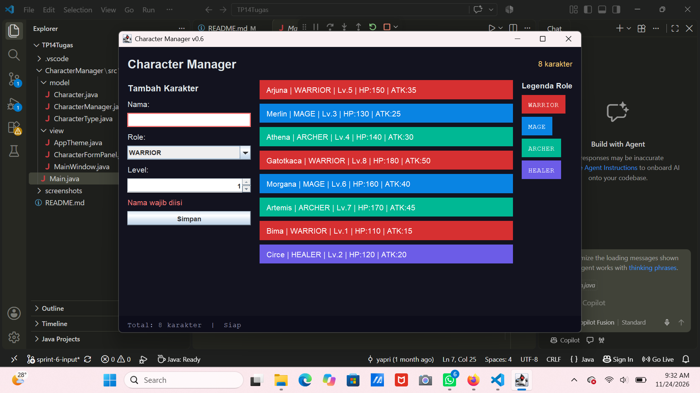
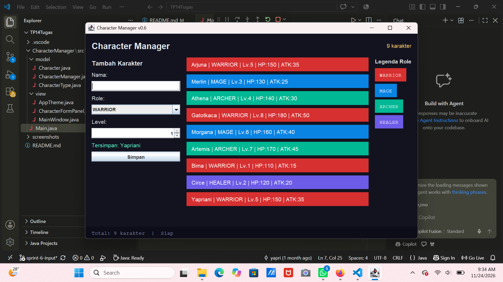

## TP14 - Sprint #6: Form Input dan Validasi

Di sprint ini Character Manager naik ke v0.6. Pengguna sekarang bisa menambah karakter sendiri lewat form yang berisi `JTextField` (nama), `JComboBox` (role), dan `JSpinner` (level 1-99). Validasinya berlapis: komponen yang membatasi pilihan, validasi bentuk di View, lalu aturan bisnis di Model.

### Screenshot

**Error nama kosong.** Border kolom nama jadi merah, pesan muncul di bawah form, dan kursor kembali ke kolom nama.

**Error nama duplikat.** Nama `arjuna` ditolak karena `isNameTaken()` tidak membedakan huruf besar dan kecil.

**Sukses.** Kartu baru langsung muncul di daftar lewat `refreshList()` tanpa menutup jendela, lalu form dikosongkan lagi.

### Aturan validasi dan lokasinya

Ada lima aturan di sprint ini. Aturan yang menyangkut data karakter aku taruh di Model, sedangkan aturan yang menyangkut cara pengguna mengetik aku taruh di View.

**1. Nama wajib, role wajib, dan level 1-99 (Model, `Character`)**
Aturan ini benar atau salah walaupun tidak ada jendela sama sekali. Karena ditaruh di konstruktor, aturannya tetap berlaku dari jalur mana pun, termasuk kalau nanti data datang dari file.

**2. Nama harus unik (Model, `CharacterManager.isNameTaken()`)**
Yang tahu seluruh daftar karakter hanya `CharacterManager`, jadi pengecekan kembar tidak boleh dilakukan sendiri oleh form. Form cuma bertanya ke Model.

**3. Mini-Challenge: MAGE maksimal level 60 (Model, `Character`)**
Aturan ini menyangkut dua field sekaligus, yaitu role dan level, sehingga tidak bisa diwakili oleh batas spinner saja. Pesannya tampil di form lewat `ex.getMessage()`, jadi `CharacterFormPanel` tidak perlu diubah sama sekali.

**4. Validasi baru 1: nama tidak boleh memakai spasi ganda (View, `CharacterFormPanel`)**
Ini kesalahan ketik, jadi paling pas dicegah di tempat pengguna mengetik, lengkap dengan pesan di dekat kolomnya. Alasan praktisnya, `Bima Sakti` dan `Bima  Sakti` (dua spasi) kelihatan sama di layar, tetapi dianggap berbeda oleh `isNameTaken()`.

**5. Validasi baru 2: daftar maksimal 10 karakter (Model, `CharacterManager`)**
Hanya `CharacterManager` yang tahu jumlah seluruh daftar. Aturan ini juga tetap masuk akal kalau aplikasi dijalankan di konsol, jadi ia milik Model.

### Hasil uji

Setiap kasus diuji langsung di aplikasi, lalu hasilnya dicatat apa adanya.

**Kasus 1: nama kosong**
- Input: kolom nama dikosongkan, klik Simpan
- Hasil diharapkan: pesan "Nama wajib diisi", border kolom nama merah, kursor di kolom nama
- Hasil nyata: [Sesuai harapan. Pesan Nama wajib diisi muncul dan kolom nama diberi border merah.]
- Lapisan yang menangkap: View (kelengkapan)

**Kasus 2: nama hanya spasi**
- Input: `   ` (tiga spasi)
- Hasil diharapkan: sama dengan kasus 1, karena `trim()` membuang spasi tepi
- Hasil nyata: [Sesuai harapan. Pesan Nama wajib diisi muncul]
- Lapisan yang menangkap: View (kelengkapan)

**Kasus 3: nama terlalu pendek**
- Input: `Ab`
- Hasil diharapkan: pesan "Nama harus 3-20 karakter"
- Hasil nyata: [Sesuai harapan. Muncul pesan Nama harus 3-20 karakter]
- Lapisan yang menangkap: View (panjang)

**Kasus 4: nama mengandung angka**
- Input: `Dewi123`
- Hasil diharapkan: pesan "Nama hanya huruf dan spasi"
- Hasil nyata: [Sesuai harapan. Muncul pesan Nama hanya huruf dan spasi]
- Lapisan yang menangkap: View (format)

**Kasus 5: nama dengan spasi ganda**
- Input: `Bima  Sakti` (dua spasi di tengah)
- Hasil diharapkan: pesan "Nama tidak boleh memakai spasi ganda"
- Hasil nyata: [Sesuai harapan. Muncul pesan Nama tidak boleh memakai spasi ganda]
- Lapisan yang menangkap: View (format, validasi baru 1)

**Kasus 6: nama sudah dipakai**
- Input: `arjuna` (Arjuna sudah ada, huruf kecil semua)
- Hasil diharapkan: pesan "Nama sudah dipakai"
- Hasil nyata: [Sesuai harapan. Muncul pesan Nama sudah dipakai]
- Lapisan yang menangkap: Model, lewat `isNameTaken()` yang dipanggil View

**Kasus 7: MAGE di atas batas level**
- Input: `Nyx`, role MAGE, level 61
- Hasil diharapkan: pesan "Role MAGE maksimal level 60" dari Model
- Hasil nyata: [Sesuai harapan. Muncul pesan Role MAGE maksimal level 60]
- Lapisan yang menangkap: Model (konstruktor `Character`, Mini-Challenge)

**Kasus 8: daftar sudah penuh**
- Input: karakter ke-11 dengan data valid
- Hasil diharapkan: pesan "Daftar penuh, maksimal 10 karakter"
- Hasil nyata: [Sesuai harapan. Muncul pesan Daftar penuh, maksimal 10 karakter]
- Lapisan yang menangkap: Model (`CharacterManager`, validasi baru 2)

**Kasus 10: level 500 diketik di spinner**
- Input: `500` diketik langsung di kolom level, klik Simpan
- Hasil diharapkan: ditolak, tidak ada karakter dengan level di atas 99 yang masuk ke daftar
- Hasil nyata: [Sesuai harapan. Ditolak, tidak ada karakter dengan level di atas 99 yang masuk ke daftar]
- Lapisan yang menangkap: komponen spinner dan Model

### Kompromi sementara di sprint ini

Tombol Simpan memakai `ActionListener` lewat lambda satu baris karena event handling baru dibahas penuh di Pertemuan 9, jadi sementara dipakai versi paling sederhana. Form juga memanggil `manager.addCharacter()` langsung dari View, padahal idealnya View hanya menampilkan data dan meneruskan kejadian. Dua hal ini sengaja dibiarkan sederhana supaya fokus sprint ini tetap di input dan validasi. Di Pertemuan 9, pemanggilan ke manager akan dipindahkan ke Controller.

### Analisis

Analisis lengkap (Bagian D): [Google Docs TP14](https://docs.google.com/document/d/1rQgcz4VJ5-2vnDvv16x8xsDx3hydfI3rAADMBEc7pTI/edit?usp=sharing)