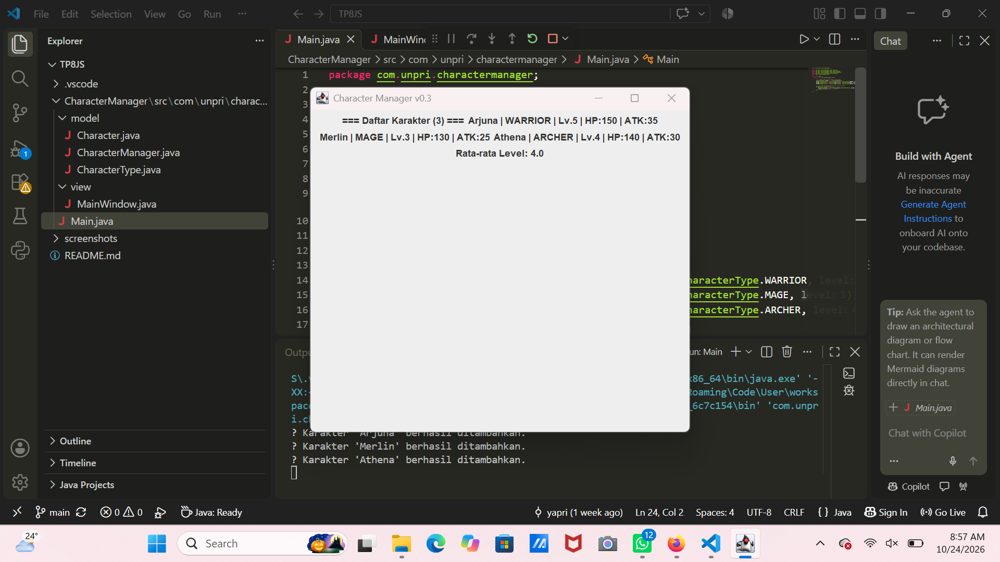
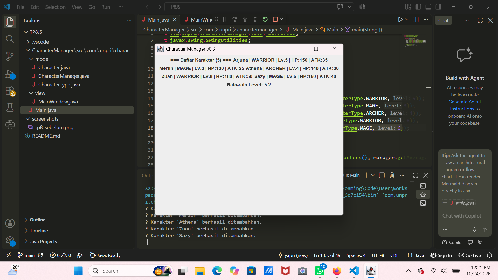

## TP8 - Character Manager Sprint #3

**Sebelum data diubah (3 karakter)**

**Sesudah data diubah (5 karakter)**

### Tampilan MainWindow
Pada TP8 ini, program Character Manager mendapat tampilan GUI pertamanya lewat `MainWindow` (package `view`) yang menampilkan daftar karakter secara dinamis dan statistik rata-rata level.

### Alur Data dan MVC
Pada `Main.java`, saya membuat objek `CharacterManager` dan menambahkan lima karakter menggunakan `addCharacter()`. Setelah itu, data karakter dan rata-rata level diambil dari `CharacterManager`, lalu dikirim ke `MainWindow` melalui constructor, sedangkan tampilan GUI dijalankan menggunakan `SwingUtilities.invokeLater()`. Di `MainWindow`, data karakter ditampilkan menggunakan perulangan agar semua karakter bisa muncul secara otomatis, sedangkan perhitungan rata-rata level tetap dilakukan di `CharacterManager`. Dengan cara ini, setiap bagian memiliki tugas masing-masing, yaitu `CharacterManager` mengurus data dan perhitungan, `MainWindow` menampilkan data, sedangkan `Main.java` mengatur jalannya program dan menghubungkan keduanya sesuai prinsip MVC.

### Karakter Baru
|   Nama   |  Tipe   | Level | Alasan  |
|   Zeus   | WARRIOR |   8   | Level tinggi untuk menguji bahwa rata-rata naik signifikan |
| Selene   |   MAGE  |   6   | Tipe MAGE kedua dengan level menengah agar data lebih bervariasi |

Dengan 5 karakter (level 5, 3, 4, 8, 6), rata-rata level menjadi 5.2.

### Analisis (Google Docs)
Link: https://docs.google.com/document/d/1I9Bntjr0DgXgoZphF_pTZcuwxol7pH8RD77cQ1SNi-Y/edit?usp=sharing