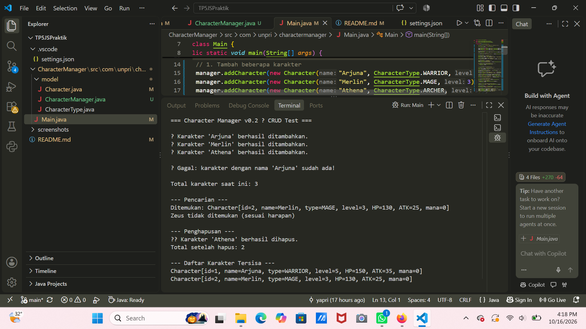
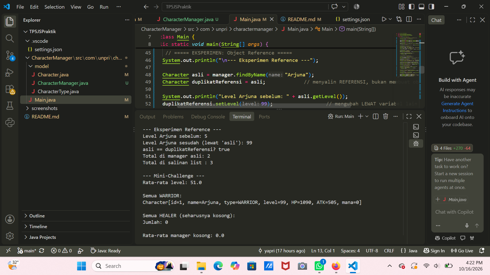
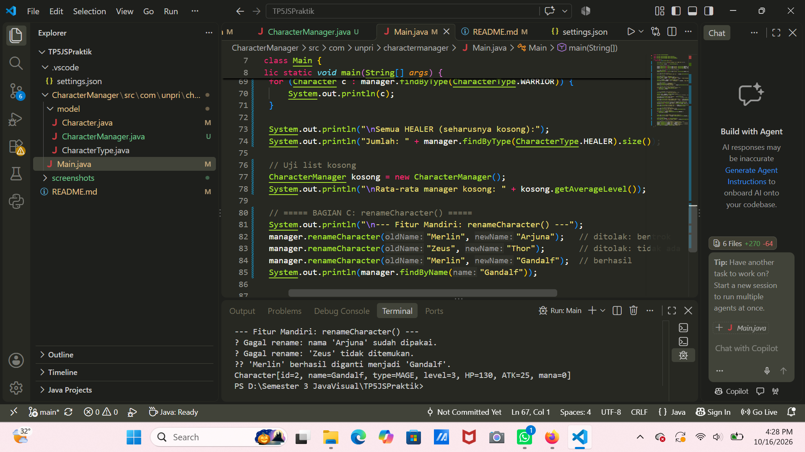

## TP5 - Character Manager Sprint #2

### Fitur Baru
Pada TP5 ini, saya mengembangkan program Character Manager dengan menambahkan beberapa method untuk mengelola data karakter, melakukan pencarian, dan menghitung statistik karakter.

Fitur yang ditambahkan meliputi:
- addCharacter(): menambahkan karakter ke dalam daftar dan menolak nama yang sudah digunakan.
- findByName(): mencari karakter berdasarkan nama.
- removeCharacter(): menghapus karakter berdasarkan nama.
- getTotalCharacters(): menghitung jumlah karakter yang tersimpan.
- getAllCharacters(): mengembalikan salinan daftar karakter agar penambahan atau penghapusan elemen pada salinan tidak mengubah daftar asli.
- equals(): membandingkan dua objek Character berdasarkan nama.
- getAverageLevel(): menghitung rata-rata level seluruh karakter dan mengembalikan 0 jika daftar kosong.
- findByType(): mencari karakter berdasarkan tipe karakter.
- renameCharacter(): mengganti nama karakter dengan validasi agar nama baru tidak kosong atau digunakan oleh karakter lain.

### Output Program
**CRUD**
Pengujian CRUD dilakukan untuk memastikan karakter dapat ditambahkan, dicari, dan dihapus. Program juga diuji untuk memastikan nama duplikat ditolak.

**Eksperimen Reference dan Defensive Copy**
Pada bagian ini, saya melakukan eksperimen untuk memahami penggunaan reference pada objek dan penerapan defensive copy.
Ketika dua variabel merujuk ke objek Character yang sama, perubahan atribut melalui salah satu variabel akan terlihat melalui variabel lainnya. Selain itu, method getAllCharacters() mengembalikan salinan daftar sehingga penambahan atau penghapusan elemen pada daftar salinan tidak mengubah daftar asli milik CharacterManager.

Namun, salinan tersebut hanya menyalin daftar, bukan objek Character di dalamnya. Oleh karena itu, perubahan atribut objek Character melalui reference dari daftar salinan tetap dapat memengaruhi objek yang sama di daftar asli.

### Fitur Mandiri: renameCharacter()
**Alasan Memilih Fitur**
Saya memilih fitur renameCharacter() karena fitur ini memungkinkan pengguna mengganti nama karakter tanpa harus menghapus dan membuat karakter baru. Dengan cara ini, karakter yang sama tetap dipertahankan, termasuk ID-nya. Misalnya, ketika nama Merlin diganti menjadi Gandalf, karakter tersebut tetap memiliki ID yang sama, yaitu id=2. Fitur ini juga dilengkapi validasi agar nama baru tidak kosong atau digunakan oleh karakter lain.

**Cara Kerja dan Validasi**
Method renameCharacter() bekerja dengan mencari karakter berdasarkan nama lama menggunakan findByName(). Jika karakter tidak ditemukan, proses penggantian nama ditolak. Selanjutnya, method memeriksa apakah nama baru kosong atau hanya berisi spasi. Setelah itu, method memeriksa apakah nama baru sudah digunakan oleh karakter lain. Jika nama tersebut sudah dipakai karakter lain, proses penggantian ditolak.
Namun, jika nama baru sama dengan nama karakter yang sedang diubah, proses tetap diizinkan. Hal ini karena findByName() mengembalikan objek yang sama dengan karakter yang dicari (bentrok == target), sehingga tidak dianggap bentrok dengan karakter lain. Penolakan hanya terjadi jika objek yang ditemukan berbeda dari karakter yang diubah (bentrok != target).

Sebagai contoh, jika renameCharacter("Gandalf", "Gandalf") dipanggil setelah Merlin berhasil diganti menjadi Gandalf, method akan mengembalikan true dan menampilkan pesan berhasil, meskipun nama karakter sebenarnya tidak berubah. Hal ini terjadi karena nama tersebut masih merujuk pada karakter yang sama, bukan karakter lain yang memiliki nama duplikat.
Jika semua validasi berhasil dilewati, nama karakter diubah menggunakan setName() dan method mengembalikan nilai true. Jika validasi gagal, method mengembalikan false.

**Penerapan Encapsulation**
Fitur ini menjaga encapsulation dengan dua cara. Pertama, renameCharacter() hanya mengembalikan nilai boolean, sehingga ArrayList asli milik CharacterManager tidak diekspos ke luar class.

Kedua, setName() pada class Character sengaja dibuat package-private (tanpa public), sehingga hanya class dalam package model, seperti CharacterManager, yang dapat memanggilnya. Jika setName() dibuat public, kode di Main.java dapat menulis manager.findByName("Merlin").setName("Arjuna"); dan melewati validasi bentrok nama, sehingga dua karakter bisa memiliki nama yang sama.

Dengan pembatasan ini, perubahan nama dari luar package dilakukan melalui renameCharacter(), sehingga validasi nama tetap dijalankan.

**Keterbatasan Fitur**
Pemeriksaan nama masih membedakan huruf besar dan huruf kecil. Sebagai contoh, nama "Arjuna" dan "arjuna" dapat dianggap berbeda.
Selain itu, findByName() mengembalikan reference ke objek Character asli di dalam daftar. Karena itu, method public lain seperti setLevel() masih dapat dipanggil dari luar class. Perlindungan pada fitur ini hanya mencakup nama, yaitu atribut yang digunakan untuk mencegah duplikat.

### Analisis (Google Docs)
Link: https://docs.google.com/document/d/1a4p4njjdctsxlZvkg8eX1nAcT8bV5sf6fG6Ndi1qgsA/edit?usp=sharing