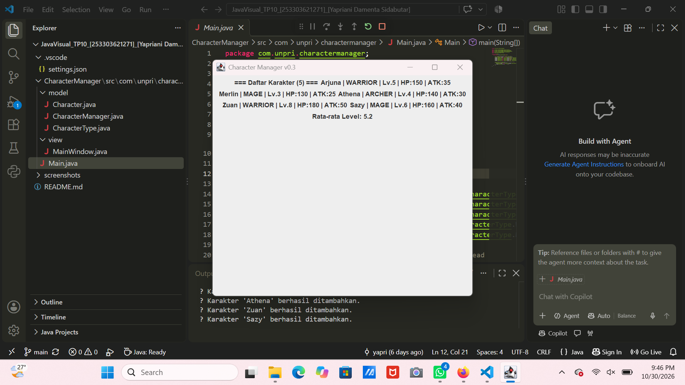
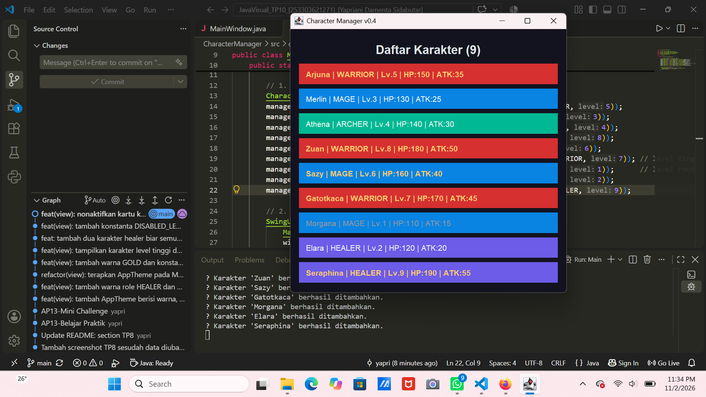
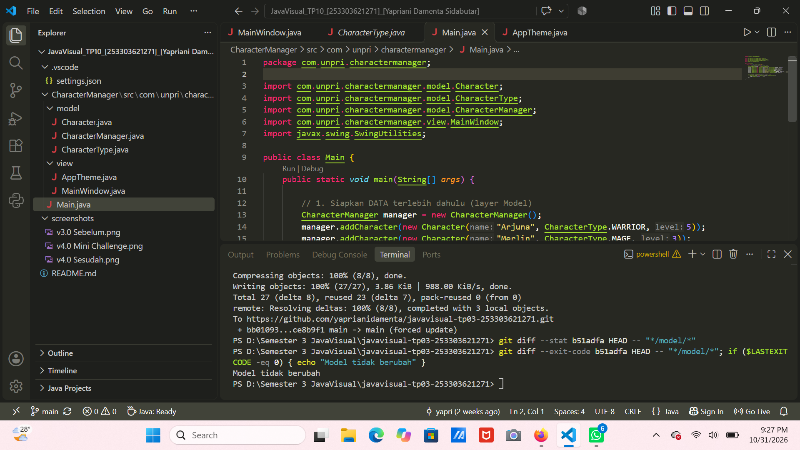

## TP10 - Theming Character Manager (Sprint #4)

Di sprint ini aku memindahkan semua urusan tampilan (warna, font, border) ke
satu class bernama `AppTheme` di package `view`, lalu `MainWindow` v0.4 memakainya.

### Tampilan sebelum dan sesudah

**Sebelum (v0.3)**

**Sesudah (v0.4)**: 9 karakter, 4 role berwarna, level tinggi emas dan tebal,
dan kartu level 1 dinonaktifkan.

**Model tidak berubah**

### Kenapa warna disimpan di AppTheme, bukan di Character?

Warna itu urusan tampilan, sedangkan `Character` hanya menyimpan data seperti
nama, level, dan HP. Kalau warna ditaruh di `Character`, class model jadi
bergantung pada `java.awt`, padahal model seharusnya bisa dipakai tanpa GUI.
Dengan `AppTheme`, kalau mau ganti tema aku cukup edit satu file tanpa menyentuh
model sama sekali. Buktinya, `git diff` untuk package `model` kosong antara
Sprint #3 dan Sprint #4.

### Dua properti tambahan

Selain warna role dan teks emas untuk level tinggi, aku nambahin dua properti
komponen Swing lagi di `MainWindow`.

**1. Tooltip per role (`setToolTipText`)**

Kartu karakter cuma nampilin nama, role, level, HP, dan ATK. Orang yang baru
buka aplikasinya belum tentu tahu apa bedanya Warrior sama Archer. Daripada
kartunya dipenuhi teks penjelasan, aku pakai tooltip yang baru muncul pas mouse
diarahkan ke kartu. Jadi tampilannya tetap rapi, tapi informasinya tetap ada
kalau dibutuhkan. Teks tooltipnya aku taruh di `AppTheme.describe()`, bukan di
`Character`, karena penjelasan itu cuma buat tampilan, bukan bagian dari data
karakter.

**2. `setEnabled(false)` untuk karakter level 1**

Karakter level 1 itu masih pemula, jadi kartunya aku bikin nonaktif supaya
langsung kelihatan beda dari karakter lain. Efeknya cuma di tampilan, data di
Model nggak aku ubah sama sekali. Batas levelnya aku simpan di konstanta
`AppTheme.DISABLED_LEVEL`, jadi kalau nanti mau diganti (misalnya level 2 juga
nonaktif), cukup ubah satu angka di satu tempat, nggak perlu cari-cari di
`MainWindow`.

Ada hal yang aku temukan pas nyoba: teks di kartu yang nonaktif otomatis jadi
abu-abu, padahal aku sudah `setForeground(TEXT_LIGHT)`. Ternyata warna teks
komponen yang disabled diatur sendiri oleh Look and Feel, jadi `setForeground`
nggak berlaku di situ. Aku biarkan saja karena memang itu perilaku bawaan Swing,
dan malah bikin kartunya kelihatan "mati" seperti yang aku mau.

### Analisis Bagian D

[Link Google Docs](https://docs.google.com/document/d/1vxYQroePyYYbB6DLnQfrNsOp3UoTcvUwCyr92Q57hjU/edit?usp=sharing)
